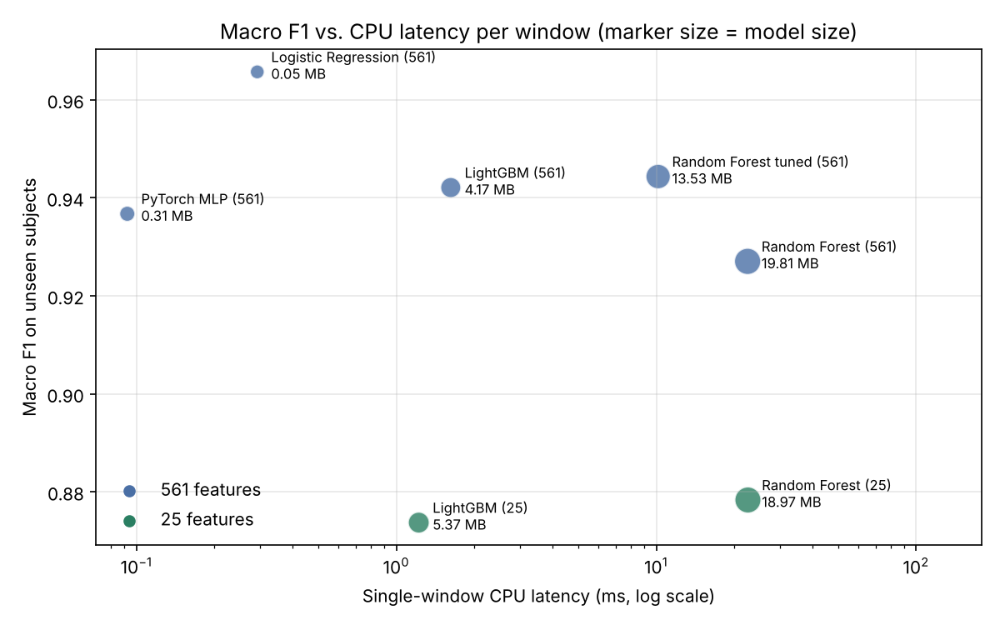
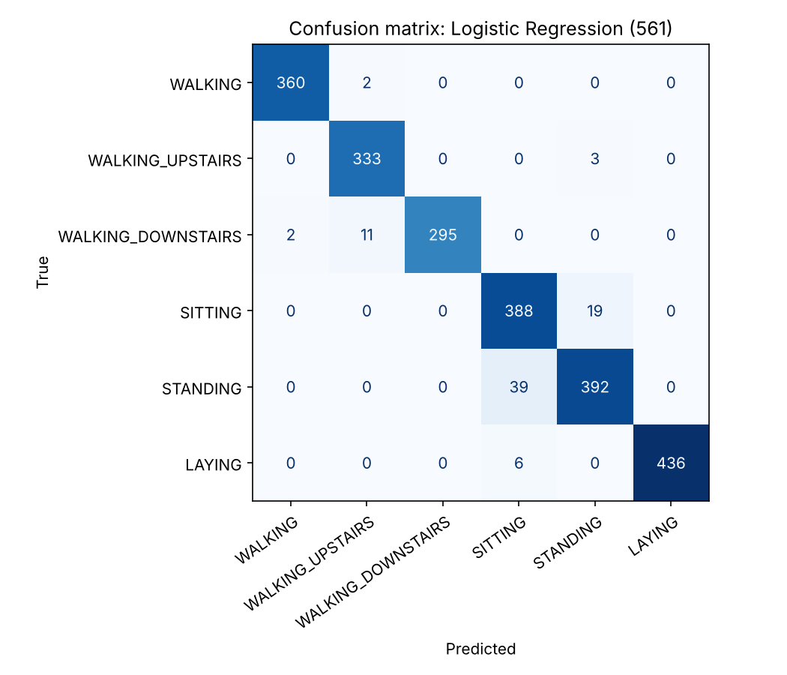
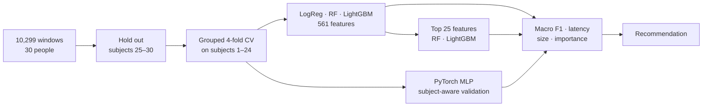

# Activity Recognition for Unseen Users on a Wearable (UCI HAR)

[](https://github.com/ndang257/edgefit-har/actions/workflows/ci.yml)


Which model should a low-cost wearable run to recognise what a **new** user is doing?
This project compares classical ML with a small neural network on the
[UCI HAR dataset](https://doi.org/10.24432/C54S4K) (30 people, 6 activities, 10,299 sensor windows,
561 engineered features). It weighs accuracy against what matters on a device: CPU latency, model size,
the number of features to compute, and interpretability.

**In short:** the simplest model won. A logistic regression recognises the six activities of people it has
never seen with a Macro F1 of 0.966, fits in 0.05 MB and predicts in under a millisecond. Boosted trees and a
PyTorch MLP were less accurate, and cutting the input from 561 to 25 features cost 5–7 points without making
the models smaller or faster.

## Results

All models are scored on six held-out people (subjects 25–30, 2,286 windows). Inference is timed on one CPU
thread.

| Model | Macro F1 | Accuracy | Features | Size | Latency per window |
|---|---:|---:|---:|---:|---:|
| **Logistic Regression** | **0.966** | **0.964** | 561 | **0.05 MB** | 0.29 ms |
| Random Forest, tuned | 0.944 | 0.948 | 561 | 13.5 MB | 10.2 ms |
| LightGBM | 0.942 | 0.941 | 561 | 4.2 MB | 1.6 ms |
| PyTorch MLP | 0.937 | 0.934 | 561 | 0.31 MB | **0.09 ms** |
| Random Forest | 0.927 | 0.928 | 561 | 19.8 MB | 22.5 ms |
| Random Forest, 25 features | 0.878 | 0.879 | 25 | 19.0 MB | 22.5 ms |
| LightGBM, 25 features | 0.874 | 0.871 | 25 | 5.4 MB | 1.2 ms |

<p align="center"></p>

- **Recommendation: Logistic Regression.** Best accuracy, smallest model, sub-millisecond inference, and
  per-class coefficients that make its decisions explainable.
- **Sitting vs. standing is the hard part.** Moving activities and laying reach F1 ≥ 0.977. Most errors are
  standing windows predicted as sitting (39) and the reverse (19): from a waist-worn phone, both postures
  are upright and still.

<p align="center"></p>

- **Deep learning didn't pay off.** On engineered features the MLP was the fastest predictor but scored 2.9
  points lower and adds a PyTorch runtime.
- **Fewer features didn't mean a smaller model.** Tree-model size depends on the number and depth of trees,
  not on the number of inputs. The 25-feature models only save on-device feature extraction.

## Approach



- **Split by person, not by row.** Each person contributes hundreds of windows with their own gait and
  phone placement. A random split would let a model recognise the *person*; splitting by subject measures
  what the product needs: performance on new users. Cross-validation and the MLP's validation set are also
  grouped by subject.
- **Macro F1 as the primary metric**, so all six activities count equally.
- **Edge benchmark** for every model: serialized size, median single-window latency after warm-up, and
  batch latency, all on one CPU thread.
- **Two views of feature importance:** impurity importance (used to pick the 25 features) and permutation
  importance by Macro F1. They disagree (Spearman ρ ≈ −0.5) because many gravity features are correlated.
- **Grouped-CV hyperparameter search** for the Random Forest, tracked with MLflow.

## Repository structure

```
├── data/                     dataset info; the data downloads to data/raw/ on first run
├── notebooks/
│   ├── 01_eda.ipynb                  data checks, class balance, why the split is by person
│   ├── 02_model_comparison.ipynb     all models, reduced features, MLP, error analysis
│   └── 03_edge_benchmark.ipynb       size, latency, importance, tuning, recommendation
├── src/edgefit/              package: data, split, models, evaluation, benchmark, pipeline
├── scripts/train.py          end-to-end training, evaluation and benchmark
├── reports/                  result tables (CSV/JSON) and figures produced by train.py
└── tests/                    unit and end-to-end tests on synthetic data (pytest)
```

## How to run

```bash
git clone https://github.com/ndang257/edgefit-har.git
cd edgefit-har
python -m venv .venv && source .venv/bin/activate   # Windows: .venv\Scripts\activate
pip install -e ".[dev]"

pytest                            # tests (seconds)
python scripts/train.py --quick   # small check run, ~1 min, writes to reports/quick/
python scripts/train.py           # full run, ~4 min on 2 CPU cores, writes to reports/
```

The first run downloads the dataset (60 MB). Notebooks 02 and 03 read the committed results in `reports/`,
so you don't need to retrain to read them. To browse the MLflow run:
`mlflow ui --backend-store-uri sqlite:///mlruns/mlflow.db`.

Timings depend on hardware. The committed results come from a 2-core Linux CPU (see notebook 03).

## Limitations and next steps

- **Small test group.** Results rest on six held-out people, and the same test set is used to compare all
  candidates. Fold-to-fold variation in cross-validation (about 2 points) is as large as some gaps between
  models. Next: leave-subjects-out cross-validation for every model, with confidence intervals.
- **Feature extraction is not timed.** Computing 561 features on a wearable is probably the real cost. Next:
  benchmark the full pipeline (feature extraction, inference, energy) on target hardware, comparing Logistic
  Regression with LightGBM on 25 features.
- **Engineered features only.** A model on the raw sensor signals (e.g. a small 1D CNN) could skip feature
  extraction entirely and is the natural next experiment for deep learning.

## Data

Reyes-Ortiz, J., Anguita, D., Ghio, A., Oneto, L. & Parra, X. (2013). *Human Activity Recognition Using
Smartphones* [Dataset]. UCI Machine Learning Repository. https://doi.org/10.24432/C54S4K (CC BY 4.0).

## License

Code: [MIT](LICENSE). Data: CC BY 4.0, see [data/README.md](data/README.md).
